

<a href="https://galles-dev.vercel.app/en">
  <picture>
    <source media="(prefers-color-scheme: dark)" srcset="assets/hero-dark.svg">
    
  </picture>
</a>

  <a href="#top"><picture><source media="(prefers-color-scheme: dark)" srcset="assets/key-0-dark.svg"></picture></a>
  <a href="#work"><picture><source media="(prefers-color-scheme: dark)" srcset="assets/key-1-dark.svg"></picture></a>
  <a href="#toolkit"><picture><source media="(prefers-color-scheme: dark)" srcset="assets/key-2-dark.svg"></picture></a>
  <a href="#method"><picture><source media="(prefers-color-scheme: dark)" srcset="assets/key-3-dark.svg"></picture></a>
  <a href="#talk"><picture><source media="(prefers-color-scheme: dark)" srcset="assets/key-4-dark.svg"></picture></a>

About 1.5 years shipping for real clients — a year in-house at [MKEY Media](https://mkeymedia.com), freelance on the side. Fast, findable sites that turn visitors into clients.

<picture>
  <source media="(prefers-color-scheme: dark)" srcset="assets/ch-1-dark.svg">
  
</picture>

<a href="https://motion-six-murex.vercel.app/demo">
  <picture>
    <source media="(prefers-color-scheme: dark)" srcset="assets/frame-motion-dark.svg">
    
  </picture>
</a>
<a href="https://snap-chef-omega.vercel.app/demo">
  <picture>
    <source media="(prefers-color-scheme: dark)" srcset="assets/frame-snapchef-dark.svg">
    
  </picture>
</a>
<a href="https://galles-dev.vercel.app/en">
  <picture>
    <source media="(prefers-color-scheme: dark)" srcset="assets/frame-site-dark.svg">
    
  </picture>
</a>
<a href="mailto:agavrik464@gmail.com?subject=Axis%20access">
  <picture>
    <source media="(prefers-color-scheme: dark)" srcset="assets/frame-axis-dark.svg">
    
  </picture>
</a>

<picture>
  <source media="(prefers-color-scheme: dark)" srcset="assets/ch-2-dark.svg">
  
</picture>

<picture>
  <source media="(prefers-color-scheme: dark)" srcset="assets/toolkit-dark.svg">
  
</picture>

<picture>
  <source media="(prefers-color-scheme: dark)" srcset="assets/ch-3-dark.svg">
  
</picture>

<b><code>01</code> &nbsp;Free first call</b>

 

We talk it through and I recommend Shopify, WordPress or a custom Next.js build — whatever fits the job. Price and timeline are agreed together, before any work starts.

<b><code>02</code> &nbsp;Work in rounds</b>

 

Edits are batched into rounds and shipped to a live version you can open and review — no screenshots-in-a-chat guessing.

<b><code>03</code> &nbsp;Launch &amp; handover</b>

 

You get every access. Small post-launch fixes are free, my own mistakes are fixed free, bigger changes are quoted separately. SEO is an optional add-on.

<picture>
  <source media="(prefers-color-scheme: dark)" srcset="assets/ch-4-dark.svg">
  
</picture>

<a href="mailto:agavrik464@gmail.com">
  <picture>
    <source media="(prefers-color-scheme: dark)" srcset="assets/contact-dark.svg">
    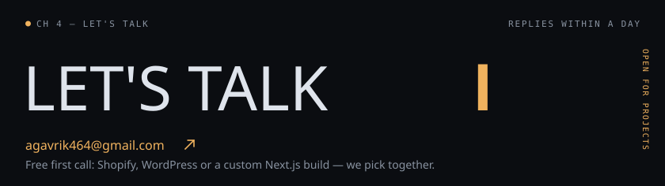
  </picture>
</a>

  <a href="mailto:agavrik464@gmail.com"><picture><source media="(prefers-color-scheme: dark)" srcset="assets/btn-email-dark.svg">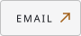</picture></a>
  <a href="https://t.me/GallessS"><picture><source media="(prefers-color-scheme: dark)" srcset="assets/btn-telegram-dark.svg">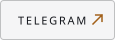</picture></a>
  <a href="https://www.upwork.com/freelancers/galles"><picture><source media="(prefers-color-scheme: dark)" srcset="assets/btn-upwork-dark.svg">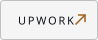</picture></a>
  <a href="https://galles-dev.vercel.app/cv/Artur_Havryk_CV_EN.pdf"><picture><source media="(prefers-color-scheme: dark)" srcset="assets/btn-cv-dark.svg">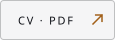</picture></a>
  <a href="https://galles-dev.vercel.app/en"><picture><source media="(prefers-color-scheme: dark)" srcset="assets/btn-portfolio-dark.svg">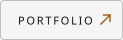</picture></a>

<b>▶ &nbsp;Roll the credits</b>

 

<picture>
  <source media="(prefers-color-scheme: dark)" srcset="assets/credits-dark.svg">
  
</picture>

<b>◉ &nbsp;Telemetry</b> — contribution reel &amp; GitHub stats

 

<picture>
  <source media="(prefers-color-scheme: dark)" srcset="https://raw.githubusercontent.com/gallesSs/gallesSs/output/snake-dark.svg">
  
</picture>

  <picture>
    <source media="(prefers-color-scheme: dark)" srcset="https://github-readme-stats.vercel.app/api?username=gallesSs&show_icons=true&hide_border=true&bg_color=0b0d11&title_color=f0b25e&text_color=dfe4ec&icon_color=f0b25e&ring_color=f0b25e">
    
  </picture>

<a href="#top">
  <picture>
    <source media="(prefers-color-scheme: dark)" srcset="assets/footer-dark.svg">
    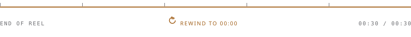
  </picture>
</a>
